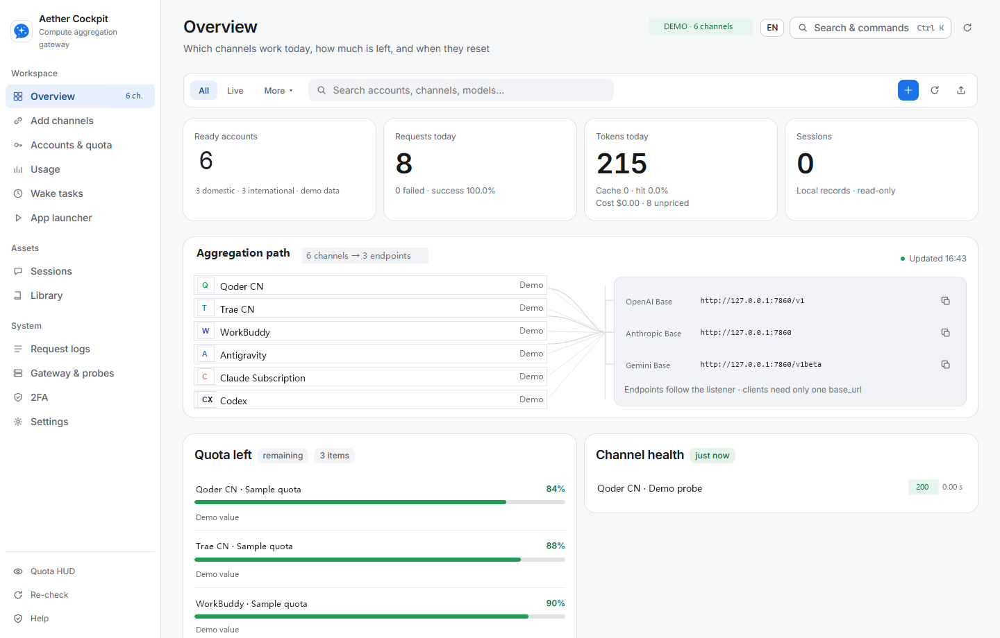
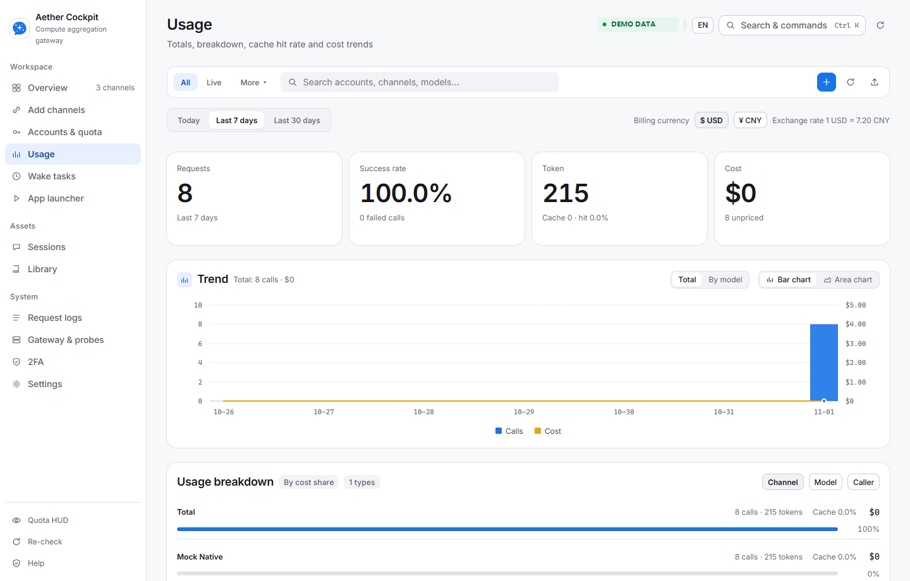
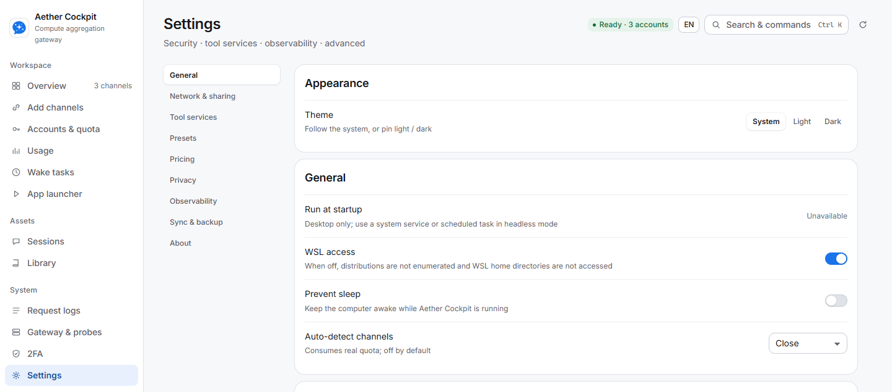

# Aether Cockpit

**简体中文：** [中文文档](README.md)

A local home for the AI coding channels spread across your CLIs, IDEs, and API settings. Aether Cockpit connects the subscriptions and model APIs you are authorized to use to one gateway, so Claude Code, Codex CLI, Gemini CLI, OpenCode, and other supported clients can reach them through familiar interfaces. Account pools, model routing, failover, quota, and usage are managed in one place.

The request path is **client → local gateway → account and model routing → your configured upstream**. Aether Cockpit handles local access, protocol adaptation, and operations; it does not host upstream accounts or replace your AI client. Credentials, request records, and runtime data stay on your machine by default, and the gateway listens on loopback unless you change it.

Start with the [Windows x64 release](https://github.com/lyydfys/aether-cockpit/releases/latest), the [quick start](docs/QUICKSTART.md), or the [feature guide](docs/FEATURES.md).

[](https://github.com/lyydfys/aether-cockpit/actions/workflows/ci.yml)
[](LICENSE)



*Provider names reflect supported integrations. Account counts, quota, calls, and probe status in this image are synthetic demo data, not live account or upstream state.*

## Get Started

If a prebuilt package is available on [GitHub Releases](https://github.com/lyydfys/aether-cockpit/releases), download and extract the Windows x64 archive. Run `AetherCockpit.exe` for the desktop app or `aether-cockpit-cli.exe` for a headless setup. The desktop app requires the Microsoft Edge WebView2 Runtime. When no release package is available, build from source using the instructions below.

The app listens on `127.0.0.1:7860` by default. Open <http://127.0.0.1:7860/>, add a provider account you are authorized to use, run a probe, then copy the client configuration from **Gateway & Probe**. Model names use the `provider/model` form; the UI and `/v1/models` endpoint show the available names.

Never publish a real gateway key, provider credential, account data, or unredacted logs in an issue or screenshot.

## Channel Coverage

The channel catalog includes subscription integrations as well as API platforms and compatible endpoints. These are representative examples; login methods, quota visibility, and model capabilities vary by provider and account. The running application shows the current catalog.

| Type | Examples |
| --- | --- |
| Domestic subscriptions and coding services | Qoder, Trae, WorkBuddy, CodeBuddy, ZCode, MiniMax |
| International subscriptions and client accounts | Claude, Codex, GitHub Copilot, Cursor, Antigravity, Kiro, Devin, OpenCode |
| APIs and cloud platforms | OpenAI-compatible endpoints, Azure OpenAI, Gemini, Vertex AI, Amazon Bedrock |

The catalog is broader than the six demo channels in the overview image. The image shows representative integrations; its account, quota, request, and probe values are synthetic and do not indicate live account state.

## What It Does

- Accepts OpenAI Chat, OpenAI Responses, Anthropic Messages, and Gemini API requests, including supported streaming and tool-call flows.
- Pools provider accounts with sticky sessions, routing groups, quota-aware strategies, and failover.
- Tracks quota, usage, costs, request logs, scheduled tasks, and provider health.
- Manages supported client configuration, prompts, Skills, MCP servers, sub-agents, and isolated client sessions.
- Keeps account credentials and runtime data in the local data directory by default, with request privacy filters and redacted exports.

See [Features and Compatibility](docs/FEATURES.md) for details and limitations.

## Call the Gateway

Discover the model names currently available from your connected accounts at `/v1/models`. Use a returned `provider-id/model-id` value in a compatible client. When a gateway key is enabled, pass it as a bearer token:

```powershell
curl.exe http://127.0.0.1:7860/v1/models `
  -H "Authorization: Bearer YOUR_GATEWAY_KEY"

curl.exe http://127.0.0.1:7860/v1/chat/completions `
  -H "Authorization: Bearer YOUR_GATEWAY_KEY" `
  -H "Content-Type: application/json" `
  -d '{"model":"<provider-id>/<model-id>","messages":[{"role":"user","content":"Hello"}]}'
```



*The request, token, and cost figures are generated by an isolated mock instance.*

## Requirements

- Prebuilt desktop app: Windows 10/11 x64 and WebView2 Runtime.
- Prebuilt headless app: Windows x64 releases are currently provided. Other platforms require a source build and independent validation.
- Source build: use the Go toolchain declared by the project. Node.js and npm are needed for frontend checks.

## Build from Source

```powershell
go test ./...
go vet ./...
go build -o cockpit.exe ./cmd/cockpit
```

Build the desktop app on Windows:

```powershell
go run ./cmd/winres-icon
go build -tags desktop,production -ldflags "-H windowsgui" -o AetherCockpit.exe ./cmd/desktop
```

Run frontend checks:

```powershell
npm ci
npm run test:ui
npm run typecheck
npm run ui:lint
```

See [CONTRIBUTING.md](CONTRIBUTING.md) for the full development gate. Real-provider smoke tests can contact upstream services and consume account quota; use the documented mock flow for routine development.

## Security and Data

Aether Cockpit is a local gateway, not a hosted proxy. It binds to loopback by default. Before enabling LAN or wider network access, set a gateway key and review allowed sources. Do not share or commit the local data directory.

Follow the terms of each provider you connect. The project does not supply accounts or authorization and cannot guarantee upstream availability or quota. See [PRIVACY.md](PRIVACY.md) for data flows and [SECURITY.md](SECURITY.md) for vulnerability reporting.



*This settings view was captured from an isolated demo profile and contains no personal credentials.*

## Documentation

- [Documentation index](docs/README.md)
- [Privacy](PRIVACY.md)
- [Quick start](docs/QUICKSTART.md)
- [Features and compatibility](docs/FEATURES.md)
- [Adding a provider](docs/ADD_PROVIDER.md)
- [Architecture](docs/ARCHITECTURE.md)
- [Changelog](CHANGELOG.md)

## Contributing

Bug reports, focused feature requests, and pull requests are welcome. Please read the [contribution guide](CONTRIBUTING.md) and [Code of Conduct](CODE_OF_CONDUCT.md) first. For general questions, see [SUPPORT.md](SUPPORT.md).

## Design references and credits

The channel catalog, routing strategies, and usage views were informed by [magpie](https://github.com/yetone/magpie) (MIT) and [sub2api](https://github.com/Wei-Shaw/sub2api) (LGPL-3.0). Thanks to their authors and contributors. No code from those projects is copied into or linked against this repository; attribution and license details are listed in [NOTICE](NOTICE).

## License

Apache License 2.0. Third-party attributions are listed in [NOTICE](NOTICE).
