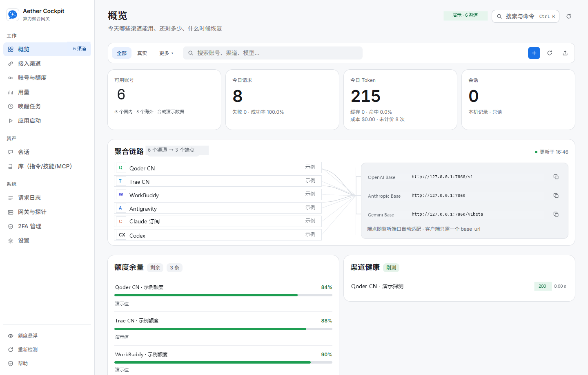
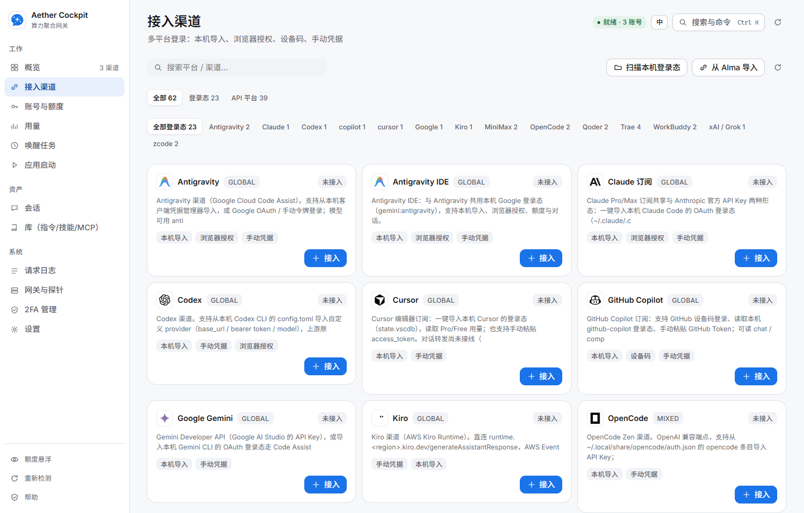
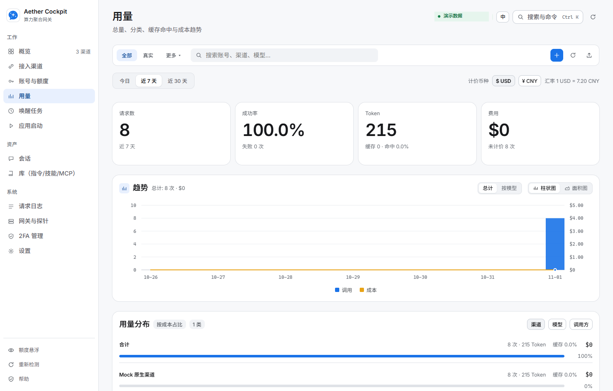
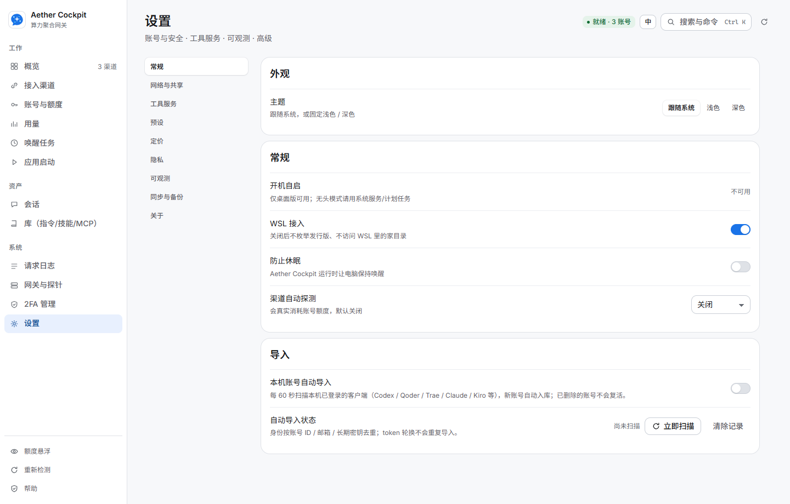

# Aether Cockpit

**English:** [README in English](README.en.md)

把分散在 CLI、IDE 和 API 配置里的 AI 编程渠道，收拢到一个本机入口。Aether Cockpit 将你有权使用的订阅账号与模型 API 接入统一网关，让 Claude Code、Codex CLI、Gemini CLI、OpenCode 等客户端使用熟悉的接口调用不同渠道；账号池、模型路由、故障转移、额度和用量也能在同一处查看。

典型请求路径是「客户端 → 本机网关 → 账号与模型路由 → 你配置的上游服务」。Aether Cockpit 负责本地接入、协议适配与运维视图，不托管上游账号，也不替代你选择的 AI 客户端。凭证、请求记录和运行数据默认保存在本机；网关默认只监听回环地址。

你可以从 [Windows x64 下载包](https://github.com/lyydfys/aether-cockpit/releases/latest)开始，或先看[快速上手](docs/QUICKSTART.md)与[能力说明](docs/FEATURES.md)。

[](https://github.com/lyydfys/aether-cockpit/actions/workflows/ci.yml)
[](LICENSE)
[](#系统要求)



*概览中的渠道名称对应项目支持的国内与海外集成类型；账号、额度、调用和探测状态均为合成演示数据，不代表真实登录或上游状态。*

## 一个入口，管理你的 AI 渠道

- **客户端各用所长：** 让支持的 AI 编程客户端共用本机网关；按客户端能力选择 OpenAI Chat、Responses、Anthropic Messages 或 Gemini API。
- **多个账号协同：** 将不同渠道账号放进账号池，通过路由组、会话粘性、轮转或额度感知策略分配请求，并在可用时故障转移。
- **运行状态集中查看：** 在一处检查模型列表、渠道额度、Token 与请求用量、成本、探测结果和请求日志。
- **把周边工作流也收拢起来：** 管理客户端连接配置、提示词、Skills、MCP 服务、子代理和独立客户端会话。

## 渠道覆盖

渠道目录包含订阅账号集成，也包含 API 平台与兼容端点。下面是项目支持类型的代表性示例；登录方式、额度信息和模型能力因渠道及账号权限而异，完整清单以应用当前版本显示为准。

| 类型 | 渠道示例 |
| --- | --- |
| 国内订阅与编程服务 | Qoder、Trae、WorkBuddy、CodeBuddy、ZCode、MiniMax |
| 海外订阅与客户端账号 | Claude、Codex、GitHub Copilot、Cursor、Antigravity、Kiro、Devin、OpenCode |
| API 与云平台 | OpenAI 兼容端点、Azure OpenAI、Gemini、Vertex AI、Amazon Bedrock |



*渠道目录展示可接入类型，不表示所有账号均已登录，也不保证每个渠道都支持相同的模型与功能。*

## 开始使用

### 下载并运行

如果 [GitHub Releases](https://github.com/lyydfys/aether-cockpit/releases) 提供了预编译包，下载 Windows x64 压缩包并解压。桌面用户运行 `AetherCockpit.exe`；无头场景运行 `aether-cockpit-cli.exe`。桌面版需要 Microsoft Edge WebView2 Runtime。没有可用发布包时，可按下方步骤从源码构建。

首次启动默认监听 `127.0.0.1:7860`，然后在浏览器打开 <http://127.0.0.1:7860/>。

### 接入一个模型

1. 在「接入渠道」添加一个你有权使用的订阅账号或 API 服务。
2. 在「网关与探针」运行探测，并复制目标客户端对应的接入配置。
3. 使用 `渠道 ID/模型名` 作为模型名，例如 `openai-compat/gpt-4.1`；可用名称以界面或 `/v1/models` 返回结果为准。

也可以先用兼容的客户端或命令行检查当前可路由模型。开启网关密钥后，将 `YOUR_GATEWAY_KEY` 替换为本机配置的密钥；示例中的模型名请替换为 `/v1/models` 返回的实际名称。

```powershell
curl.exe http://127.0.0.1:7860/v1/models `
  -H "Authorization: Bearer YOUR_GATEWAY_KEY"

curl.exe http://127.0.0.1:7860/v1/chat/completions `
  -H "Authorization: Bearer YOUR_GATEWAY_KEY" `
  -H "Content-Type: application/json" `
  -d '{"model":"<provider-id>/<model-id>","messages":[{"role":"user","content":"你好"}]}'
```

客户端配置可能包含网关密钥。请从界面复制并保存在本机，不要把真实密钥粘贴到公开 Issue、截图或日志中。

## 能力概览

| 场景 | 能力 |
| --- | --- |
| 统一接入 | OpenAI Chat、OpenAI Responses、Anthropic Messages、Gemini API；支持相应流式请求与工具调用 |
| 账号与渠道 | 订阅渠道、本机授权导入、通用 OpenAI 兼容服务、账号池、标签、批量管理、自动刷新与健康探测 |
| 模型路由 | 粘性会话、优先级/轮转/额度感知/意图路由、虚拟模型组、故障转移与模型白名单 |
| 客户端工作流 | 为多个 AI 客户端写入或恢复网关配置；管理提示词、Skills、MCP、子代理及独立客户端实例 |
| 用量与运维 | 额度和成本视图、请求日志、定时任务、备份导入导出、WebDAV 同步、健康与版本端点 |
| 本机隐私 | 默认回环监听；账号凭证留在本机数据目录；支持请求隐私遮蔽和敏感信息脱敏导出 |

按渠道和功能域整理的说明见[能力与兼容性](docs/FEATURES.md)。各服务商接口、额度、授权方式和使用条款会变化，具体兼容性以当前版本及各渠道说明为准。


*渠道目录列出当前版本支持的接入类型；列表数量表示渠道类型，不表示本机已登录账号数。*



*用量截图中的请求数、Token 数和成本是隔离 mock 实例生成的演示统计。*

## 系统要求

- 预编译桌面版：Windows 10/11 x64；需要 WebView2 Runtime。
- 预编译无头版：当前 Release 提供 Windows x64。其他平台请按源码构建并自行验证。
- 从源码构建：使用项目声明的 Go 工具链；前端检查需要 Node.js 与 npm。

## 从源码构建

```powershell
go test ./...
go vet ./...
go build -o cockpit.exe ./cmd/cockpit
```

桌面应用构建（Windows）：

```powershell
go run ./cmd/winres-icon
go build -tags desktop,production -ldflags "-H windowsgui" -o AetherCockpit.exe ./cmd/desktop
```

前端质量检查：

```powershell
npm ci
npm run test:ui
npm run typecheck
npm run ui:lint
```

维护者完整门禁和开发环境说明见[贡献指南](CONTRIBUTING.md)。真实渠道冒烟测试可能调用上游并消耗账号额度；日常开发应使用文档中说明的 mock 流程。

## 安全与数据

Aether Cockpit 是本机网关，不是托管代理服务。默认只绑定回环地址；开放到局域网或其他网络前，先设置网关密钥并检查允许访问的来源。数据目录包含本机账号和运行数据，不应直接分享或提交。

使用第三方订阅或服务时，请遵守对应服务商的条款。项目不提供账号、授权或对上游稳定性和额度的保证。数据流说明见 [PRIVACY.md](PRIVACY.md)；漏洞报告方式见 [SECURITY.md](SECURITY.md)。



*设置截图取自隔离演示配置；页面只展示本机选项，不包含个人凭据。*

## 文档

- [文档索引](docs/README.md)：用户指南、开发文档与架构说明
- [隐私说明](PRIVACY.md)：本机数据、上游请求、日志与可选导出
- [快速上手](docs/QUICKSTART.md)：首次启动、安全设置、客户端接入与常见问题
- [能力与兼容性](docs/FEATURES.md)：协议、渠道类别、运维能力与限制
- [新增渠道](docs/ADD_PROVIDER.md)：Provider 与 spec 扩展指南
- [架构说明](docs/ARCHITECTURE.md)：核心模块和请求处理流程
- [更新日志](CHANGELOG.md)

## 参与项目

欢迎通过 Issue 报告可复现的问题、提出改进建议，或提交 Pull Request。提交前请阅读[贡献指南](CONTRIBUTING.md)和[行为准则](CODE_OF_CONDUCT.md)。支持渠道见 [SUPPORT.md](SUPPORT.md)。

## 赞助支持

如果这个项目帮到了你，欢迎点一个 Star、分享项目，或通过收款码支持持续开发与维护。赞助完全自愿，不影响任何功能。

<table>
  <tr>
    <td align="center"><br/>支付宝</td>
    <td align="center"><br/>微信支付</td>
  </tr>
</table>

其他支持方式见[赞助支持](docs/DONATE.md)。

## 设计参考与致谢

渠道目录、路由策略与用量视图的设计参考了 [magpie](https://github.com/yetone/magpie)（MIT）与 [sub2api](https://github.com/Wei-Shaw/sub2api)（LGPL-3.0）。感谢两个项目的作者与贡献者。这些项目的代码未被复制或链接进本仓库，署名与许可信息见 [NOTICE](NOTICE)。

## 许可证

本项目使用 [Apache License 2.0](LICENSE)。第三方组件的归属信息见 [NOTICE](NOTICE)。
