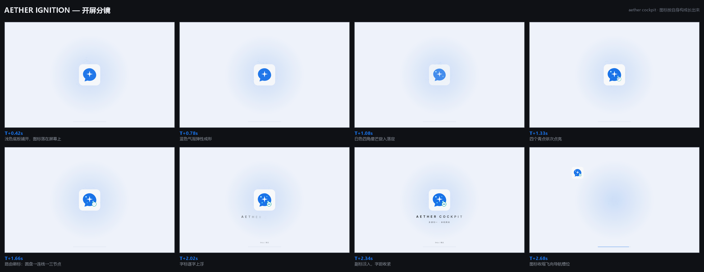

# 设计说明：Aether Cockpit 官网

这份文档解释「为什么长这样」，可与 [README](./README.md) 里的技术说明对照阅读。

---

## 1. 一切以项目自身的资产为准

本站的标识与色系**不是设计出来的，是抄来的**——抄的是项目里已经存在、且已被应用各处使用的权威定义：

| 来源 | 抄了什么 |
|---|---|
| [`internal/web/ui2/assets/aether-cockpit.svg`](../internal/web/ui2/assets/aether-cockpit.svg) | 图标的全部几何：气泡 path、星芒 path、4 个青点的圆心与半径、路由徽标的圆/线/节点坐标 |
| [`internal/web/ui2/css/tokens.css`](../internal/web/ui2/css/tokens.css) | 暗色/浅色两套表面色、唯一的强调色、状态色、字体栈、卡片描边语义 |
| [`mobile/android/.../ic_brand_mark.xml`](../mobile/android/app/src/main/res/drawable/ic_brand_mark.xml) | 光学尺寸规则：24–28dp 用简化版（只留气泡+星芒），≥40dp 才用完整版 |
| [`docs/assets/brand-optical-sizes.png`](../docs/assets/brand-optical-sizes.png) | 上面那条规则的可视化验证 |

### 1.1 图标构成（不可省略的四层 + 底板）

1. **浅色底板** `#F8F9FA`，108×108、`rx=20`；
2. **蓝色对话气泡** `#1A73E8`，尾巴朝左下；
3. **白色四角星芒**，是视觉重心；
4. **四个青点**：`#CCFFFF` × 2 + `#80FFFF` × 2，这是品牌的一部分，删掉就不是这个图标了；
5. **右下角路由徽标**：白色圆盘 + `#13A99B` 描边 + `#1A73E8` 连线 + 三个节点（青-蓝-青）。

**底板不是装饰，是细节可见的前提。**
图标在深色背景上直接放会只剩气泡与星芒：青点半径 3.5/2.5/2.0（108 坐标系），
缩到 36px 时约 1.2–2.3px，在深底上会糊成脏点。带上 `#F8F9FA` 底板后，
它同时复现了 `appicon.png` 在系统中的真实呈现，青点与路由盘都有对比度可依。

实测（`check-legibility.py`）：

| 尺寸 | 青点 #CCFFFF | 青点 #80FFFF | 路由盘薄荷 | 说明 |
|---|---|---|---|---|
| 36px（导航实际尺寸） | 15 px | 10 px | 6 px | 可辨 |
| 28px | 10 px | 10 px | 6 px | 勉强可辨，已是下限 |
| 96px（开屏） | 77 px | 37 px | 39 px | 清晰 |

因此**全站统一使用完整图标**（含青点与路由标），不再提供"简化版"：
导航 36px、页脚 36px、开屏 `clamp(132px, 16vw, 180px)`。
几何集中在一个 `<symbol id="bm-full">` 里，改一处全站生效。

### 1.2 色板

| 用途 | 值 | 出处 |
|---|---|---|
| 暗色底 | `#0f1115` | `tokens.css` 暗色 `--bg` |
| 暗色卡片 | `#1b1f26` / `#22272f` | `--card` / `--surface-2` 等价层级 |
| 描边 | `#2a2f38` / `#414855` | `--line` / `--line-strong` |
| 文本 | `#e8eaee` / `#b9bfc9` / `#8d949f` | `--fg` / `--fg-2` / `--muted` |
| **唯一强调色** | `#1a73e8` | `--accent` |
| 浅色反转区 | `#f7f8fa` 底 / `#ffffff` 卡 / `#17181b` 字 | 浅色主题同名字段 |
| 薄荷 / 冰蓝 | `#13a99b` / `#ccffff` | **只用于图标与路由语义**，不作界面主色 |

关键约束：**界面只有一个强调色**。这一点和 App 一致，
所以站内没有第二种"品牌色"去抢视觉；薄荷绿只在图标的徽标里出现，
在页面上也只用于表示"落位/命中"这类和路由有关的瞬间。

---

## 2. 与参考站为什么不一样

参考站解决「在多个 CLI 工具之间切换」，视觉母题是**开关**；
Aether Cockpit 解决「多个上游汇聚成一个端点」，母题是**汇流**。
两者抽象层次不同，所以没有沿用任何一处的布局、动效或文案结构。

| 维度 | 切换叙事 | 本站（汇流叙事） |
|---|---|---|
| 首屏主角 | 工具图标矩阵 | 源 → 汇聚 → 端点 的链路卡 |
| 开屏 | 图标逐个点亮 | 让 App 图标按自身构成顺序"长出来"，再飞进导航 |
| 主要交互 | 把工具拖进/拖出 | 点策略，看请求落到哪个账号 |
| 色彩语义 | 单一强调色 | 同样单一强调色，但仅蓝色；绿只限图标 |

---

## 3. 开屏动效：让图标自己成形

整段约 2.6 秒进正题。它的叙事不是"画一个抽象图形"，
而是**按图标真实的构成顺序，一层一层把它装配出来**，最后飞进导航栏——
这一步把"开屏"和"站内品牌"连成同一件事。

### 3.1 分镜



| 时刻 | 画面 | 对应图标层 |
|---|---|---|
| `T+0` | 粒子沿图标外缘汇入，缓慢涡旋 | —（以太氛围） |
| `T+0.26s` | 浅色底板铺开，图标"落在"屏幕上 | 层 1 |
| `T+0.50s` | 蓝色气泡弹性放大成形 | 层 2 |
| `T+0.86s` | 白色四角星芒旋入、放大落定 | 层 3 |
| `T+1.16s` | 四个青点错峰点亮（带放大回弹） | 层 4 |
| `T+1.44s` | 白盘 → 连线 → 三个节点依次到位 | 层 5（路由徽标） |
| `T+1.90s` | 字标逐字上浮 | — |
| `T+2.12s` | 副标淡入、字距收紧 | — |
| `T+2.48s` | 图标收缩飞向导航槽位 | — |
| `T+3.02s` | 遮罩揭开 | — |

### 3.2 几个关键决定

**最后一拍给了路由徽标。**
它是图标里信息量最大的一笔（圆盘 + 三节点），也是"Aether Cockpit = 路由"的字面表达。
如果几层同时出现，这个细节会被淹没；单独给它约 450ms，观众才读得懂那不是装饰。

**青点带「放大回弹」。**
1.4px 的点在动画里几乎无声无息，所以每个点除了淡入还从 `scale(0.4)` 弹到 1，
配 100ms 错峰——观众才注意到"这里还有四个点"。

**底板单独一拍，且轻微回弹。**
先把"纸面"放上去，后续每个元件才有落点。
这也让开屏的开头有一个含蓄的物理感：图标是落在屏幕上，不是淡进来的。

**粒子从图标外缘出发，不是从屏幕边缘。**
圆心取图标真实 `getBoundingClientRect()`，起始半径是图标半径的 1.18–1.8 倍。
所以粒子看起来是"归位"，而不是"从四面八方飞过来"。

**飞入是真的 FLIP。**
起飞前量图标与导航槽位的位置差，直接写 `transform`，
任何视口宽度都精确落进 36×36 的槽位；落位时导航里的静态标记同步显形。
由于占位与飞行的都是同一个完整图标，落位瞬间没有形变跳变。

### 3.3 降级与可访问性

- **可跳过**：点遮罩空白、按 `Esc`、点 `Skip / 跳过`，三种方式直达终态。
- **减少动效**：`prefers-reduced-motion` 下时间轴压到 30%。
- **无 JS**：`<noscript>` 隐藏开屏、复位揭示元素。
- **键盘**：动效层 `role="presentation"`，结束后 `aria-hidden` + `display:none`；
  页面顶部有 skip-link。
- **画布按 1.5 倍采样**：纯氛围层，2 倍下粒子在 HiDPI 会掉帧。

---

## 4. 首屏：双端并列，不是一句「都支持」

首屏的任务不是讲功能，而是让人一眼分清「这是两个平台、各有各的样子」。

```
┌─────────────────────┬──────────────────────────┐
│  标题 / 副标 / CTA    │   桌面版：一台笔记本       │
│  元信息               │   （真实概览截图）         │
│  [桌面版][手机版]  ← 平台开关                     │
├─────────────────────┴──────────────────────────┤
│  手机版：四张并排 — 概览 / 设置 / 额度 / 更多      │
└───────────────────────────────────────────────┘
```

### 4.1 为什么是这个构图

一开始试过「桌面整行在上、手机四张在下」，结果是首屏被拉到 2200px＋，
手机直接掉出第一屏——等于白放。
也试过「左右两栏各自成套」，手机在 634px 的右栏里只排得下 4 列各 143px，
比原来的小卡片还小。

最后采用**三区域网格**：文字与桌面共享第一行，手机横跨整行占第二行。

| 版本 | 首屏高 | 手机宽度 | 四张都在首屏 |
|---|---|---|---|
| 上下堆叠 | 2212px | 277px | 否 |
| 左右两栏 | 1407px | 143px | 是（但太小） |
| **三区域网格** | **1615px** | **281px** | 主体可见，底部留一点滚动暗示 |

手机宽 281px，比最初那版 168px 的小卡片大了 67%，界面上的数字与标题都看得清。

### 4.2 平台开关是真的换构图

标签不是筛选器，而是**展台重心**：

- **桌面版**（默认）：桌面大图在右栏主位，手机退成整行一侧；
- **手机版**：网格重排为 `copy | mob` + `desk` 整行，四张手机升到主位（281×554），
  桌面缩成横跨整行的淡出小窗。

切换后首屏高度从 1615px 变为 1775px——这是构图真的变了，不是只改了透明度。

非焦点那一侧只做轻微 `opacity` 退让，**不做灰度**：
手机截图是应用的真实界面，压成灰块会让人以为它不可用。

---

## 5. 配色：黑、白、柔光玻璃（默认）

参考站与多数 AI 工具站只有暗色。这里做了**可切换的黑白双主题**，
两套都对齐 App 自己的 `tokens.css`：

| | 黑（默认） | 白 |
|---|---|---|
| 背景 | `#0f1115` | `#f7f8fa` |
| 卡片 | `#1b1f26` | `#ffffff` |
| 描边 | `#2a2f38` | `#dfe2e7` |
| 正文 | `#e8eaee` | `#17181b` |
| 次文 | `#b9bfc9` | `#3c4045` |
| 强调 | `#1a73e8`（暗底用 `#4a9bf5`） | `#1a73e8` |
| 反转区 | 米白 `#f7f8fa` | 近黑 `#0f1115` |

**默认用柔光玻璃。**
玻璃是这套站点的品牌表情——它把「材质」这件事讲清楚了，
而黑白是它的降级档：需要极致克制或极致清爽时再切。
因此默认不跟随系统偏好：访客系统是深色，也先看到玻璃；
真要暗色，自己点一下月亮，选择会被记住。

几个决定：

- **强调色只有一种**，两套主题都是同一个蓝；黑主题下亮一档（`#4a9bf5`）保证对比度。
- **反转区跟着翻转**：黑主题里"安全"段是白的，白主题里它变成黑的——
  区块对比关系保持，不是简单反色。
- **首帧不闪**：`<head>` 里的内联脚本在样式表之后、`body` 之前定主题，
  读取 `localStorage` → 系统偏好 → 默认黑，避免先渲染错误配色再跳。
- **切换有过渡**：点击时给 `<html>` 挂 300ms 的 `.theme-fade`，
  只过渡颜色属性，不触发布局。
- **图标底板不随主题变**：`#f8f9fa` 是品牌固定值，两套主题下都保持，
  否则青点又会失去对比度。

---

## 5.5 柔光玻璃（第三套主题）

黑与白是「平面 + 描边」，玻璃是「材质 + 厚度」——它不是在黑白上换个色，
而是换了整套表面构成，所以单独拥有一组 token（`--glass-*`）。

### 5.5.1 依据

两套系统的公开描述被直接映射成可实现的条目：

| 来源 | 原话 | 本站实现 |
|---|---|---|
| HyperOS 4 | *Sense ambient colors and blend in seamlessly* | 面板不填实色，用多层半透明渐变叠 `backdrop-filter`，颜色取自背后内容 |
| HyperOS 4 | *Tap to see light glow, responses shine* | 按下时整块发亮，边缘高光 `--g-rim` 提到 1.35 |
| HyperOS 4 | *Drag to see light flow* | 指针位置写入 `--gx/--gy`，高光点跟随并收紧 |
| Liquid Glass | *displacement-first, blur-second* | 边缘做「亮边 + 内渐隐」，中心才散焦；不是整块糊成一片 |
| Liquid Glass | *physics: F0 = 0.04, squircle n≈4* | 面板圆角统一 `--r-lg/--r-xl`，避免硬描边，用内高光定义边缘 |

一条明确的取舍：**不做纯玻璃拟态**。
「半透明 + 大模糊」谁都能做，但那样读起来是「贴纸」；
这里的边缘比中心更亮更锐，才有玻璃被光穿过的感觉。

### 5.5.2 三层结构

```
┌─────────────────────────────┐
│ 1. 填充：多层半透明渐变      │  ← 环境色感知：上缘偏冷、下缘偏青
│ 2. ::before 亮边（1px + mask）│  ← 折射亮边：替代实线描边
│ 3. ::after 内柔光（screen）   │  ← 光被"收"在边缘
│ 4. .g-gloss 跟随光点          │  ← 交互光效
└─────────────────────────────┘
      backdrop-filter: blur(22px) saturate(1.35)
```

关键实现细节：

- **亮边用 `mask-composite: exclude`**，只保留 1px 的环，
  比 `border` 更接近玻璃的"边缘厚度"；`border` 会显得像画框。
- **高光层 `pointer-events: none`**，否则它会吞掉按钮点击。
- **光点跟随只挂 `pointermove`**，不做每帧 rAF；
  长页面上几十个卡片各自 rAF 会明显吃帧。
- **按下亮度只提 6% 左右**——这是设备实测给出的量级，
  提到 50% 会像闪光灯而不是按压反馈。

### 5.5.3 浅色玻璃的关键差异

从深色玻璃改成浅色，不是把变量取反那么简单，有四处必须反着做：

| 项目 | 深色玻璃 | 浅色玻璃 | 为什么 |
|---|---|---|---|
| 下缘边光 | 更白的「反光」 | **冷灰收边**（`rgba(148,168,198,.4)`） | 白底上用白做下缘会完全看不见，玻璃就"漏"了 |
| 内层柔光 | `mix-blend-mode: screen` | `normal` | screen 在浅底上会把颜色洗成一片白 |
| 光点混合 | `plus-lighter` | `screen` + 冷调 | plus-lighter 在浅底上等于什么都没做 |
| 屏幕描边 | 白色内描边 | 冷灰细描边 | 白色屏幕配白色描边会与机身粘连 |

另外两处细节：手机「刘海」从深色改成浅灰（机身色），
代码块改用浅底深语法色（`#0b6b62` / `#1a5fb4`），保证浅色下的可读性。

### 5.5.4 与另两套主题的差异

| | 黑 | 白 | 柔光玻璃（默认） |
|---|---|---|---|
| 底色 | `#0f1115` 实色 | `#f7f8fa` 实色 | `#eef2fa` + 三段淡彩径向渐变 |
| 卡片 | 实色 + 1px 描边 | 实色 + 1px 描边 | 白色半透明（62–90%）+ blur + 内高光 |
| 边缘 | 描边定义形状 | 描边定义形状 | 上缘实白高光 + 下缘冷灰收边 |
| 反转区 | 翻成米白 | 翻成近黑 | 翻成**深色玻璃**（浅底上的反差锚点） |
| 交互 | 无 | 无 | 光点跟随、按下发亮 |

玻璃主题下的反转区是**深色玻璃**，不是白色。
浅色玻璃整体是"白 + 淡彩"，如果反转区也翻转成白，整页就没有明暗落差了；
翻成深色玻璃，既保留材质语言（同一种玻璃、不同明度），
又给长页面一个呼吸点。黑白主题的翻转是"翻页"，玻璃主题的翻转是"换色号"。

---

## 6. 页面结构

十三个分区，节奏是「一句论点 → 一个可验证的证据」：

| 分区 | 主张 | 证据形态 |
|---|---|---|
| Hero | 把散落的渠道收拢成一个入口 | 可复制端点的链路卡 |
| 能力矩阵 | 多出来的是同一张网关上的一层调度 | 六张卡，每张带能力标签 |
| 工作台 | 四个页面把运维缩到一屏 | 可标签切换的真实截图 |
| 调度策略 | 同一个请求，四种分发方式 | **可点击**的路由图 |
| 渠道覆盖 | 订阅、API 平台、兼容端点 | 19 个渠道网格 |
| 安全 | 它是本机网关，不是托管代理 | 浅色反转区，四条具体承诺 |
| 下载 | 两条产物，同名同版本 | 文件名、体积、前置条件 |
| 快速开始 | 从安装到第一个请求 | 三步 + 可复制的 curl |
| FAQ | 上手最容易卡住的几件事 | 六条折叠问答 |
| 结尾 | 让渠道各就各位 | 双 CTA |

**浅色反转区是刻意的。** 整页深色，唯独安全一段翻成 `#f7f8fa`——
正是 App 浅色主题的底色，所以翻过去像"切了一下主题"，而不是贴了块白板。

**数字都标了出处。** 协议 4、渠道类型 19、平台 2 来自 README；
截图注明「演示数据」，避免把合成数据当成真实运行状态。

---

## 7. 交互

- **工作台标签页**：`role="tablist"`，支持 `←` `→` `Home` `End`。
- **路由策略**：四个策略，点击后账号高亮、链路流动、文案更新；
  滚到该区会自动示范一次「轮转 → 粘性」。
- **复制**：端点与 curl 一键复制，优先 `navigator.clipboard`，回退 `execCommand`。
- **滚动揭示**：`IntersectionObserver` + `--d` 错峰，触发一次即解绑。
- **锚点跳转**：补偿 76px 固定导航高度。
- **导航吸附**：滚动超过 12px 才加背景与描边。

---

## 8. 响应式

断点 1024 / 900 / 760 / 420：导航逐级收窄，最后只留 GitHub 与下载；
网格单列化；手机截图区域两列 → 一列。

路由图用 `aspect-ratio: 340/300` 与 SVG `viewBox` 同比例，节点百分比定位，
任意宽度下曲线与圆点严格对齐。

---

## 9. 性能

- 零构建、零框架：一个 HTML、一份 CSS、两份 JS（约 100 KB，不含图片）。
- 字体本地自托管（Inter + Noto Sans SC 三字重），带 OFL 许可文本，无第三方请求。
- 图片 `loading="lazy"`；动画只用 `transform` / `opacity`。

---

## 10. 如何改

| 想改 | 改哪里 |
|---|---|
| 文案 | `index.html` 对应分区 |
| 色系 | `assets/css/site.css` 顶部 `:root`（已对齐 tokens.css，改前请同步 App） |
| 图标几何 | `index.html` 顶部的 `<symbol id="bm-full">` / `bm-simple` |
| 开屏节奏 | `assets/js/ignition.js` 里的 `T` 对象 |
| 截图 | 替换 `assets/img/shots/*.png`（保持 1440×920 / 720×1600） |

改完跑：

```powershell
cd website
python scripts/serve.py 8125
node scripts/test-interactions.mjs http://127.0.0.1:8125/index.html
node scripts/check-timeline.mjs http://127.0.0.1:8125/index.html   # 五层出现顺序
python scripts/check-brand-static.py   # 图标/配色回归闸口
python scripts/check-legibility.py     # 小尺寸细节可辨性
python scripts/make_storyboard.py      # 开屏改动后重生成分镜图
```

